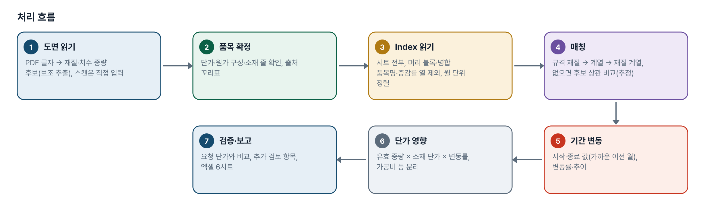
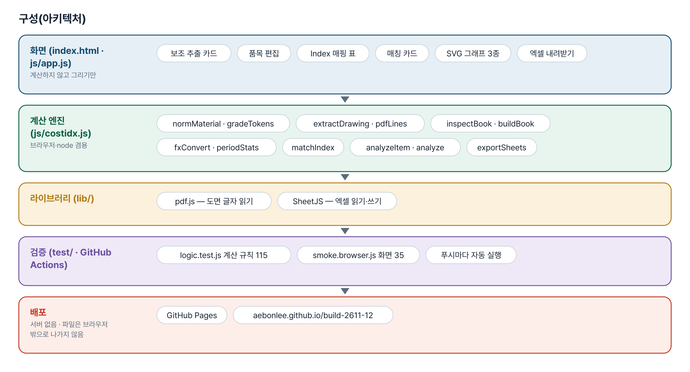
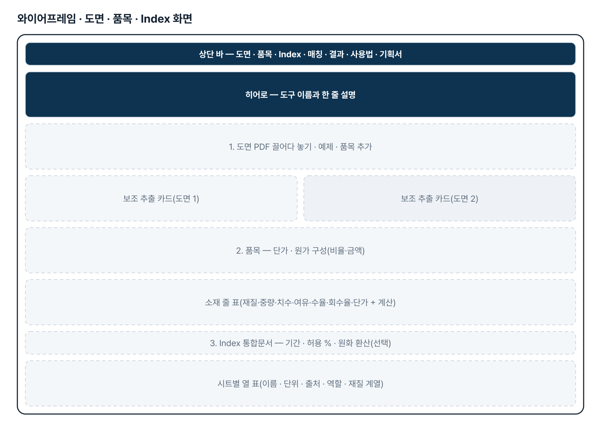
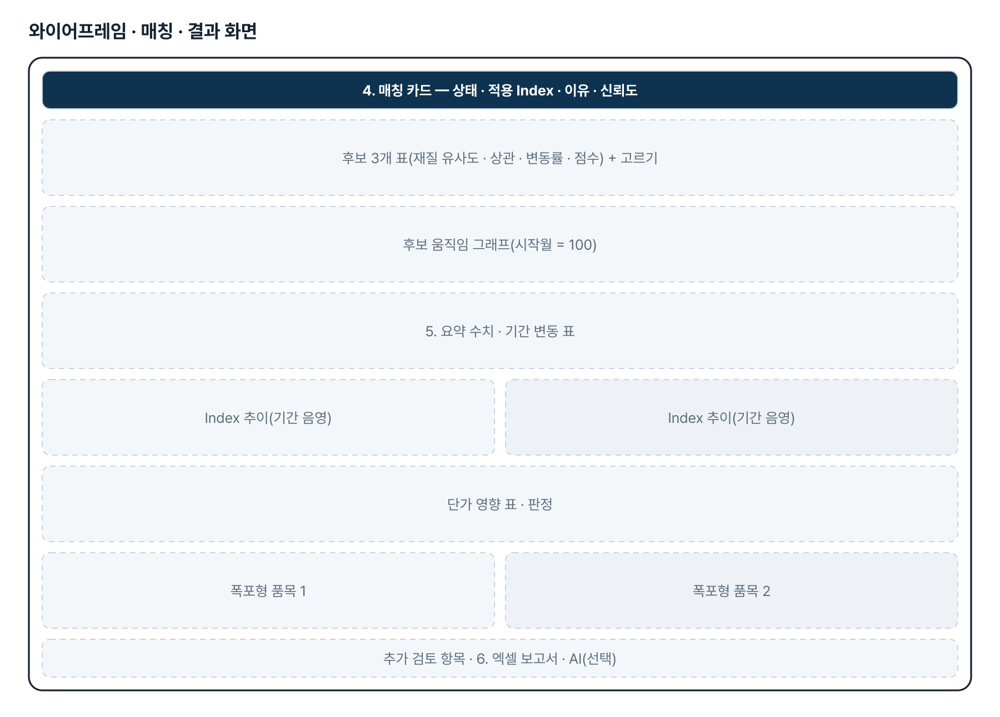
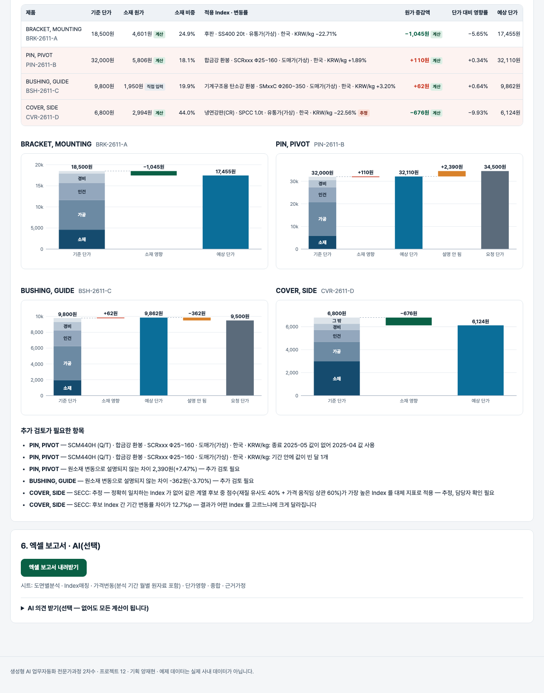

# 도면 기반 원소재 단가 영향 분석 — 프로젝트 기획서 v1.1

- 기획: 양재현 · 작성일 2026-11-03 · 생성형 AI 업무자동화 전문가과정 · 2차수 프로젝트 12
- 바로 쓰기: https://build-2611-12.jobability.co.kr/
- 워드 판: `docs/기획서/build-2611-12_양재현_도면기반원소재단가영향분석_기획서_v1.1.docx`

## 개요

도면 PDF 에서 재질·치수·중량을 읽고, 올린 원자재 가격 통합문서(실무 「원자재 가격 동향」 형식 포함)로 분석 기간의 가격 변동률을 구해 소재 원가 × 변동률만큼의 제품 단가 영향을 계산하는 브라우저 도구입니다. 규격 칸의 재질로 Index 를 맞추고, 맞는 Index 가 없으면 같은 계열 후보를 가격 움직임으로 비교해 추정으로 보여 줍니다.

### 배경 · 현재 업무
- 협력업체가 원자재 가격 상승을 이유로 단가 인상을 요청하면, 구매 담당자는 도면의 재질·중량과 원자재 Index 를 손으로 맞춰 영향을 따져야 합니다.
- 도면 재질(SM45C·SCM440 등)과 Index 이름(열연·특수강 등)이 1:1 로 맞지 않아 대체 Index 를 고르는 근거가 사람마다 다릅니다.
- 원소재 변동만으로 설명되는 인상분과 추가 검토가 필요한 차이를 근거와 함께 구분해 보여 줄 도구가 필요합니다.

### 목표
- 도면 PDF 에서 재질·치수·중량·수량을 보조 추출하고, 스캔 도면은 직접 입력합니다.
- 올린 엑셀에 있는 Index 만으로 정확 일치 · 추정(후보 3개와 근거) · 분석 불가를 가립니다.
- 분석 기간의 Index 변동률 × 소재 원가로 원가 증감액과 단가 영향률을 계산하고 가공비 등은 따로 둡니다.
- 요청 단가와 비교해 설명 안 되는 차이를 추가 검토로 표시하고 엑셀 보고서로 내보냅니다.

## 요구사항과 구현

| 기획서 요구 | 구현 |
|---|---|
| 도면 PDF 업로드 · 재질·규격·사용량 추출 | pdf.js 동봉, 표제란 글자에서 후보와 출처 줄(보조 추출), 스캔은 직접 입력 |
| Index 엑셀 업로드, 열·시트가 달라도 매칭 | 시트·날짜 열 고르기, 열마다 역할(Index·참고 계열·제외)과 재질 계열 |
| (v1.1) 실무 원자재 가격 통합문서 그대로 읽기 | 시트 여러 장, A열 낱말 머리 블록, 병합 품목명 물려받기, 연·월 결합, 증감률·분기 열 제외, 최신이 위 정렬 |
| (v1.1) 규격 재질로 정확 일치 · 단위 · 출처 | 규격 재질 일치 → xx 계열 일치 → 재질 계열, 한국·KRW/kg 우선, 단위별 표, 환율 시트 원화 환산(선택), 출처·상세출처 근거 |
| 정확 일치 Index 우선, 없으면 가격 움직임으로 유사 Index | 같은 계열 후보 × 월간 변동률 상관 → 점수, 후보 3개 · 근거 · 신뢰도 · 고르기 |
| 유사성 낮으면 담당자 확인, 없으면 분석 불가 | 추정은 늘 담당자 확인, 후보 없음·재질 불명은 분석 불가, 여러 Index 일치는 선택 전 계산 안 함 |
| 시작·종료일 데이터 없으면 가까운 관측일 + 날짜 표시 | 가장 가까운 이전 월 사용, 사용 월 표시 |
| 소재 규격·절단 여유·수율·스크랩 회수 | 소재 규격 + 절단 여유 → 투입 중량, 유효 중량 = 투입 − 스크랩 × 회수율, 가정 기본값 표시 |
| 원가 증감액·영향률·소재 합산·가공비 등 별도 | 소재 원가 × 변동률, 단가 대비 영향률, 소재 줄 합산, 가공·인건·경비 분리 |
| 결과 검증 · 엑셀 보고서 | 설명 안 되는 차이 · 소재 하락·단가 상승 표시, 엑셀 6시트 |

## 주요 기능

- **도면 보조 추출** — 글자 PDF 의 표제란에서 품명·도번·재질·중량·수량·완성 치수·소재 규격 후보를 찾아 몇째 줄에서 읽었는지와 함께 보여 줍니다.
- **품목 · 원가 구성** — 기준·요청 단가, 원가 구성(비율 또는 금액), 소재 줄(재질·중량·치수·여유·수율·회수율·소재 단가). 값마다 출처 꼬리표가 붙습니다.
- **Index 엑셀 · 기간** — 시트를 모두 읽어 머리 블록(Item·지역·기준·단위·규격·출처)이나 날짜 열을 찾습니다. 증감률·분기 열은 빼고, 열마다 이름·단위·출처와 역할(Index·참고 계열·쓰지 않음)을 보여 줍니다.
- **매칭** — 규격 재질 일치 · 계열 일치(SMxxC) · 재질 계열 일치 · 여러 개 · 추정 · 분석 불가를 가립니다. 적용 Index 의 출처·상세출처를 근거로 보여 주고, 추정은 후보 3개의 상관·변동률·점수를 보여 줍니다.
- **결과 · 검증** — 기간 변동 표, 추이 그래프(기간 음영), 단가 영향 표, 폭포형, 추가 검토 항목을 보여 줍니다.
- **엑셀 보고서 · AI(선택)** — 도면별분석·Index매칭·가격변동·단가영향·종합·근거가정 6시트. AI 의견은 재질명과 Index 이름만 보내고 계산에 쓰지 않습니다.

## 처리 흐름(파이프라인)

1. **도면 읽기** — PDF 글자 → 재질·치수·중량 후보(보조 추출), 스캔은 직접 입력
2. **품목 확정** — 단가·원가 구성·소재 줄 확인, 출처 꼬리표
3. **Index 읽기** — 시트 전부, 머리 블록·병합 품목명·증감률 열 제외, 월 단위 정렬
4. **매칭** — 규격 재질 → 계열 → 재질 계열, 없으면 후보 상관 비교(추정)
5. **기간 변동** — 시작·종료 값(가까운 이전 월), 변동률·추이
6. **단가 영향** — 유효 중량 × 소재 단가 × 변동률, 가공비 등 분리
7. **검증·보고** — 요청 단가와 비교, 추가 검토 항목, 엑셀 6시트

## 구성(아키텍처)

- **화면 (index.html · js/app.js)** — 보조 추출 카드 · 품목 편집 · Index 매핑 표 · 매칭 카드 · SVG 그래프 3종 · 엑셀 내려받기
- **계산 엔진 (js/costidx.js)** — normMaterial · gradeTokens · extractDrawing · pdfLines · inspectBook · buildBook · fxConvert · periodStats · matchIndex · analyzeItem · analyze · exportSheets
- **라이브러리 (lib/)** — pdf.js — 도면 글자 읽기 · SheetJS — 엑셀 읽기·쓰기
- **검증 (test/ · GitHub Actions)** — logic.test.js 계산 규칙 115 · smoke.browser.js 화면 35 · 푸시마다 자동 실행
- **배포** — GitHub Pages · aebonlee.github.io/build-2611-12

## 화면 구성(와이어프레임)

## 규칙 · 판정 기준

- 엑셀에 있는 Index 만 씁니다. 외부 시세·인터넷 검색을 쓰지 않고 엑셀에 없는 Index 를 만들지 않습니다.
- 통합문서는 A열 낱말로 머리 블록을 찾고, 단위가 적힌 열만 Index 후보로 씁니다(단위가 빈 숫자 열은 증감률).
- 규격 칸 재질이 같으면 규격 재질 일치, SMxxC 같은 묶음 표기에 들면 계열 일치. 여럿이면 한국·KRW/kg 우선, 그래도 같으면 고르지 않습니다.
- 같은 계열 Index 가 하나면 그것만 씁니다. 여럿이면 담당자가 고를 때까지 계산하지 않습니다.
- 정확 일치가 없으면 재질 유사도 0.5 이상 후보를 점수(재질 0.4 + 월간 변동률 상관 0.6)로 정렬해 추정 — 담당자 확인으로 표시합니다.
- 시작·종료월 값이 없으면 가장 가까운 이전 월 값을 쓰고 사용 월을 표시합니다.
- 유효 중량 = 투입 중량 − 스크랩 × 회수율, 소재 원가 = 유효 중량 × 소재 단가, 원가 증감액 = 소재 원가 × Index 변동률.
- 요청 단가 변동과 소재 영향의 차이가 기준 단가의 허용 % 를 넘으면 추가 검토, 소재 하락인데 단가 상승이면 따로 표시합니다.

## 검증

- 계산 규칙 테스트 115개 · 화면 연기 테스트 35개 통과
- v1.1 에서 계산 테스트 84 → 115, 화면 테스트 30 → 35.
- 일부러 깨뜨려 확인 — 증감률 열 포함·병합 물려받기·세로 병합 연도·분기 열·원화 우선·사내 구매가·xx 계열·지역/단위 우선·H 표준화·환산 곱셈을 바꾸면 각각 테스트가 실패합니다.
- 화면 테스트: 예제 통합문서(시트 5장) → 매칭 4종 → 원화 환산 → 내려받은 통합문서 다시 올리기 → 열 빼기 → v1.0 단순 표 → 360px.

## 이번 판에서 하지 않는 것

- 글자 PDF 의 표제란만 읽습니다. 스캔 도면 OCR 과 형상에서 치수 읽기는 하지 않습니다.
- 중량 계산은 봉재·판재·파이프만 합니다. 다른 형상은 도면 중량이나 직접 입력을 씁니다.
- 유사 Index 는 실제 원소재 가격이 아니라 변동을 추정하는 대체 지표입니다. 원소재 자체 계열이 없으면 후보끼리의 움직임 일치도로 비교합니다.
- USD·RMB 환산은 톤·kg 단위만 합니다(US￠/kg · USD/bbl 은 바꾸지 않음). 통합문서 안 차트는 읽지 않습니다.
- 실제 통합문서는 구조만 받아 가짜 예제로 검증했습니다. 기획자 실파일로 한 번 확인이 필요합니다.

## 다음 단계

- 기획자 실파일로 읽지 못한 시트·계열 모름 열 확인 후 표 보강
- 사내 구매가 열을 기본 비교 기준으로 쓰는 선택
- 품목 목록 엑셀 일괄 올리기 · 도면 자동 짝짓기
- 형상 추가(육각봉·각관·앵글)

## 버전 이력

- **v1.1** (2026-11-03) — 실무 「원자재 가격 동향」 통합문서 형식 읽기 — 시트 여러 장, A열 낱말 머리 블록, 병합 품목명, 연·월 결합(세로 병합 연도), 증감률·분기 열 제외, 최신이 위 정렬, PMI 「2026-5」 날짜 / Index 이름 = 품목 · 규격 · 기준 · 지역 · 단위, 규격 재질 일치 · xx 계열 일치 · 한국/KRW 우선 매칭 / 단위별 결과 표, 비철 원화 열 우선, 환율 시트 원화 환산(선택), 출처·상세출처 근거 표시, 사내 구매가 열은 참고 계열 / 가짜 예제 통합문서(시트 5장)와 4번째 예제 품목(SECC, 추정), 계산 테스트 115 · 화면 테스트 35
- **v1.0** (2026-11-03) — 첫 판 — 도면 보조 추출·품목 원가 구성·Index 엑셀 매핑·정확/추정 매칭·기간 변동·단가 영향·검증·엑셀 보고서 / 기획서 워드 판·파이프라인·아키텍처·와이어프레임 추가
